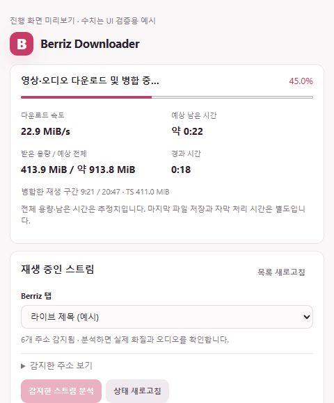

# Berriz Downloader

Berriz 다시보기를 원본 화질의 영상과 자막으로 저장하는 브라우저 확장 프로그램입니다.

**확장 하나만 설치하면 됩니다.** 분리된 영상과 오디오를 브라우저에서 합쳐 TS 파일로 저장하며, FFmpeg·yt-dlp 등 별도 프로그램이 필요하지 않습니다. 영상은 Berriz에서 직접 내려받고 사용자 PC에서 처리합니다.

**[다운로드](https://github.com/reiseo/berriz-downloader/releases/latest)**

## 주요 기능

- **자동 분석** — 다시보기를 재생하고 팝업을 열면 감지된 스트림을 분석합니다.
- **화질 선택** — 제공되는 화질 중 최고 화질을 기본으로 선택합니다.
- **원본 저장** — 영상과 오디오를 재인코딩 없이 하나의 TS 파일로 합칩니다.
- **자막 다운로드** — 언어를 선택해 영상과 함께 받거나 자막만 저장할 수 있습니다. SRT가 기본이며 VTT 또는 두 형식 모두를 선택할 수 있습니다.
- **자동 파일명** — 재생 페이지의 날짜·아티스트·제목으로 파일 이름을 만들며 직접 수정할 수 있습니다.
- **진행 상황 표시** — 다운로드 속도, 진행률, 용량, 예상 남은 시간을 확인할 수 있습니다. 팝업을 닫아도 다운로드는 계속됩니다.

## 설치

Chrome 116 이상에 해당하는 기능을 사용하는 Chromium 확장입니다. Chrome·Edge·Whale 계열을 대상으로 하며, 브라우저 버전에 따라 지원 여부가 달라질 수 있습니다.

1. [다운로드 페이지](https://github.com/reiseo/berriz-downloader/releases/latest)의 **Assets**에서 `Berriz-Replay-Saver-v*.zip` 파일을 받습니다.
2. ZIP의 압축을 완전히 풉니다.
3. 브라우저의 확장 관리 페이지에서 **개발자 모드**를 켭니다.
4. **압축해제된 확장 프로그램을 로드**를 누르고, **`manifest.json`이 바로 들어 있는 폴더**를 선택합니다.
5. Berriz 재생 페이지를 새로고침합니다.

| 브라우저 | 확장 관리 주소 |
| --- | --- |
| Chrome | `chrome://extensions` |
| Edge | `edge://extensions` |
| Whale | `whale://extensions` |

설치용 ZIP에는 `manifest.json`이 최상위에 들어 있습니다. **압축을 푼 폴더 자체를 선택하세요.** `docs` 폴더를 선택할 필요는 없습니다. GitHub의 `Source code`를 내려받았다면 저장소 안의 `extension` 폴더를 선택합니다.

## 사용 방법

1. Berriz에 로그인하고 저장할 다시보기를 재생합니다.
2. 확장 아이콘을 눌러 자동 분석 결과를 확인합니다.
3. 화질, 파일 이름, 함께 받을 자막을 선택합니다.
4. **TS 다운로드**를 누릅니다. 영상과 선택한 자막이 각각 저장됩니다.

자막만 받으려면 **선택한 자막만 다운로드**를 누르세요. 화질과 자막 언어는 해당 콘텐츠에서 제공하는 범위 안에서 선택할 수 있습니다.

기본 저장 위치는 **브라우저 다운로드 폴더 / Berriz**입니다. 하위 폴더 입력란에서 `Berriz/IVE`처럼 지정할 수 있고, 기본 다운로드 위치는 브라우저 설정에서 변경할 수 있습니다.

파일 이름은 `YYMMDD 아티스트/멤버 라이브 제목` 형식입니다. 페이지에서 읽지 못한 정보는 **파일 이름 정보**에서 보완하거나 최종 이름을 직접 수정할 수 있습니다.

```text
Berriz/
  261102 IVE 안유진 라이브 제목.ts
  261102 IVE 안유진 라이브 제목.ko.srt
  261102 IVE 안유진 라이브 제목.en.srt
```

## 화면 예시



*UI 예시 화면입니다. 표시된 수치는 실제 다운로드 속도를 의미하지 않습니다.*

## 알아두기

- **다운로드 속도**: 별도 속도 제한은 없습니다. 실제 속도는 Berriz CDN, 네트워크, PC 성능에 따라 달라지며 전체 용량과 남은 시간은 추정치입니다.
- **자막 형식**: SRT와 VTT는 같은 원본 문장과 시간 정보를 사용합니다. SRT에는 VTT 전용 위치·스타일 정보가 포함되지 않습니다. 자막은 영상에 입히지 않고 별도 파일로 저장합니다.
- **지원 콘텐츠**: 종료된 다시보기의 H.264 영상·AAC 오디오를 포함하는 MPEG-TS 기반 HLS를 지원합니다. 진행 중인 라이브, DRM·암호화, fMP4, 바이트 범위, 타임라인 단절 스트림과 중간 이어받기는 지원하지 않습니다.
- **브라우저 실행**: 다운로드가 끝날 때까지 브라우저를 켜 두세요. 확장을 새로고침하거나 비활성화하면 작업이 중단됩니다.
- **저장 공간**: 임시 파일 저장을 위해 결과 파일 크기의 약 2배 이상 여유 공간을 권장합니다. 브라우저 프로필이 있는 드라이브에도 공간이 필요합니다.

## 문제 해결

| 증상 | 확인할 내용 |
| --- | --- |
| 매니페스트를 찾을 수 없음 | ZIP을 압축 해제했는지, 선택한 폴더 바로 안에 `manifest.json`이 있는지 확인하세요. |
| 스트림이 표시되지 않음 / 주소 만료 | Berriz 재생 페이지를 새로고침하고 다시 재생하세요. |
| 원하는 화질이 표시되지 않음 | 재생 페이지에서 해당 화질을 선택한 뒤 다시 분석하세요. 마스터 m3u8 주소를 직접 입력할 수도 있습니다. |
| 파일 이름 정보가 비어 있음 | 재생 페이지를 새로고침하거나 팝업의 **파일 이름 정보**에서 직접 입력하세요. |
| 파일 저장 대기 | 브라우저 다운로드 목록에서 일시정지나 확인 요청을 확인하세요. |
| 공간 부족 | 브라우저 프로필과 다운로드 폴더가 있는 드라이브의 여유 공간을 확인하세요. |

## 개발

`extension/`에 확장 코드가 들어 있습니다. 별도 빌드 없이 이 폴더를 브라우저에 로드할 수 있습니다.

개발용 검증에는 Node.js, 배포 ZIP 생성에는 Windows PowerShell을 사용합니다.

```powershell
node --test tests/media-core.test.cjs tests/background.test.cjs tests/offscreen.test.cjs tests/replay-info.test.cjs
powershell -NoProfile -ExecutionPolicy Bypass -File tools/package-browser.ps1
```

미디어 샘플은 저장소에 포함하지 않으며, 샘플이 필요한 검사는 파일이 없으면 건너뜁니다. 검증 범위와 제한은 [검증 기록](VERIFICATION.md)에서 확인할 수 있습니다. 실제 설치된 Chrome·Whale 확장의 전체 다운로드부터 최종 저장까지 통합 검증은 아직 완료하지 않았습니다.
